# 单词卡布局原型（一次性，不合并产品）

对应决策：[学习入口与移动端布局](https://github.com/longzhuzhu/quiz-app/issues/58)。

## 验证问题

保留三个来源入口、移动端沉浸学习、桌面端保留既有导航时，哪一种单词卡布局最适合反复翻面、标记与阅读长释义？

本分支只用于布局讨论，不是可上线实现。所有内容与数量均为演示；HTTP 在 Axios adapter 边界替换为内存数据，真实变更请求被禁止。学习记录不持久化；仅为复用应用导航提供本开发端口的假登录身份。不要连接生产域名或真实后端。

## 运行

在本原型分支安装已有前端依赖后：

```bash
cd frontend
npm run prototype:vocab
```

打开 `http://127.0.0.1:5108/exams/prototype/vocab?variant=A`。无需登录或后端。

- `variant=A`：大卡片学习（推荐），去掉学习时无关的统计，单词／中文作为视觉中心。
- `variant=B`：统计侧栏，桌面显示侧栏、手机显示计数行，适合更关注本轮标记的用户。
- `variant=C`：阅读优先，独立展示当前单词，卡片内容顶端左对齐，便于长释义阅读。
- 底部浮动条仅为原型工具，可循环切换 A/B/C；左右方向键也切换方案，输入控件聚焦时不拦截。
- “场景”菜单可查看长释义、缺中文、来源入口、管理入口、结束页及切换明暗主题。
- 卡片可点击翻面；横向拖动或左右滑动只切词；标记仅更新演示内存状态并前进。

直接进入某个场景：在同一路由追加 `screen=study&source=exam_personal&sample=long` 或 `sample=missing`。来源入口不指定 `screen`；管理入口用 `screen=manage`。

## 用户已经确认的边界

- 保留项目词汇、我的单词本、高频词汇三个入口卡片，点击后进入学习；高频词沿用题库选择，不混池。
- 移动端沉浸，隐藏全局导航；桌面端保留全局导航。
- 点击单词卡显示中文；左“未记住”、右“已记住”；标记成功后自动下一张，横滑只切卡。
- 触控目标至少 48×48 CSS px，主要判断按钮高至少 52px，操作间距至少 8px；动态视口和安全区处理；支持减少动效。

排序、跳过统计、长期掌握状态与本轮结果之间的映射、撤销、恢复等未决规则仍由各自决策票处理。演示中的内存逻辑不是对这些规则的决策；长释义和缺中文只用于检验空间和入口，不批准新 AI 能力。

## 预览

### 大卡片学习（A，推荐）

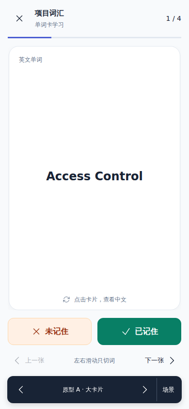
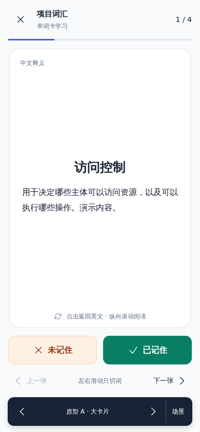
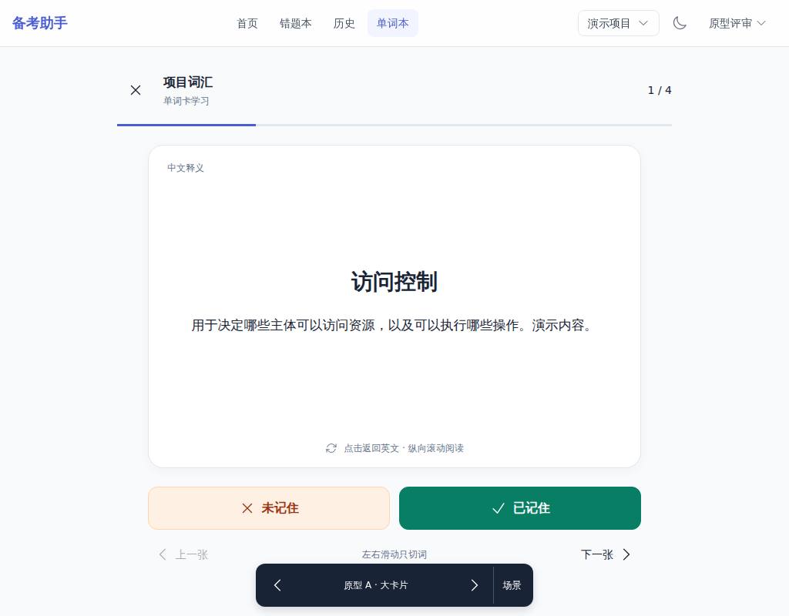

### 统计侧栏（B）

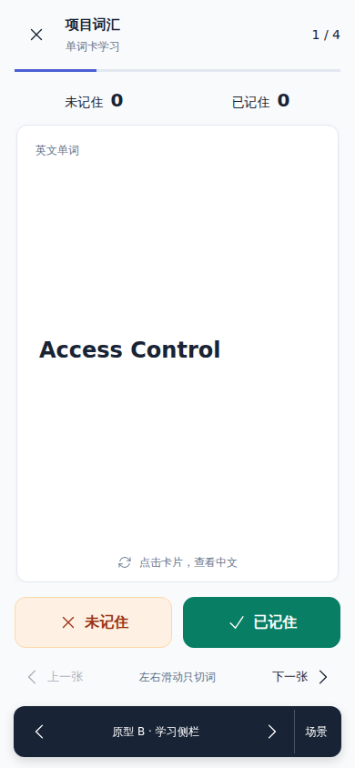
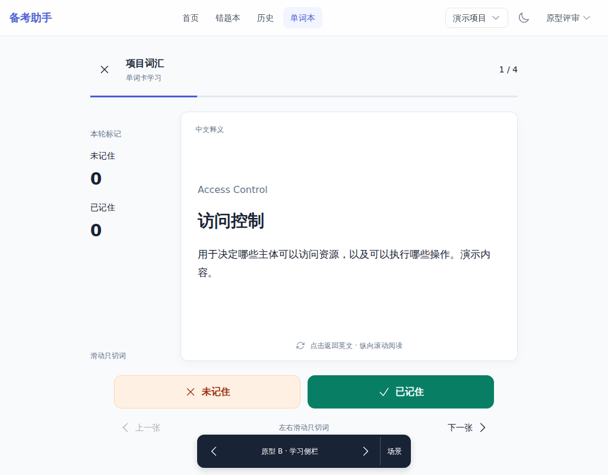

### 阅读优先（C）

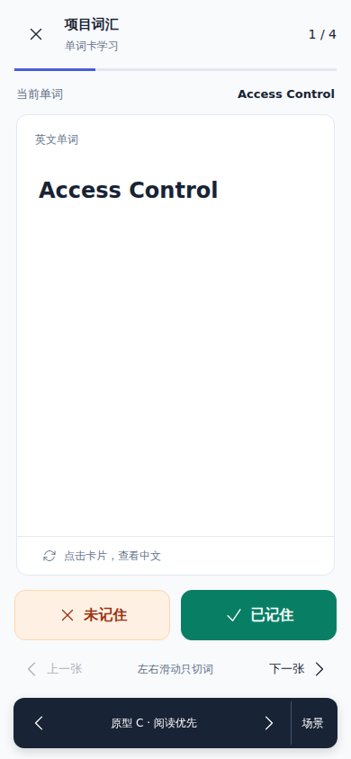
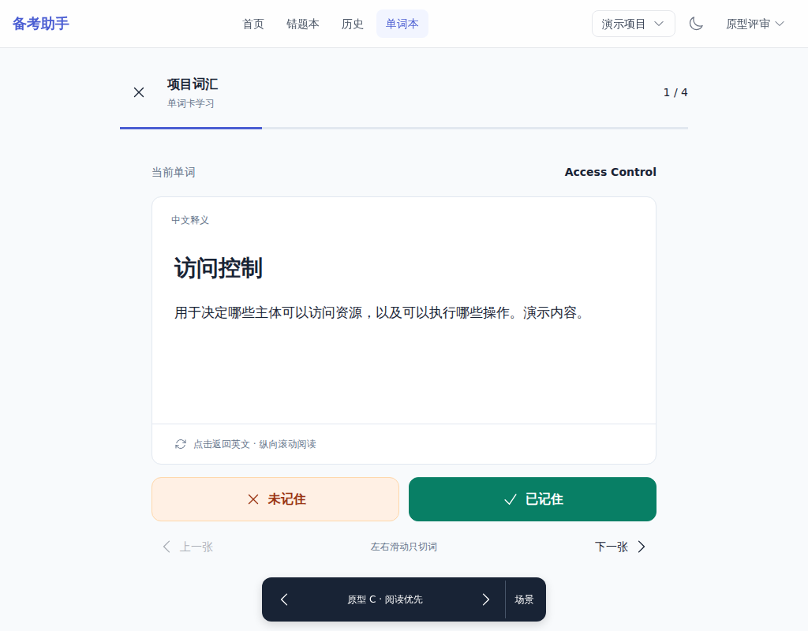

### 共同入口与边界


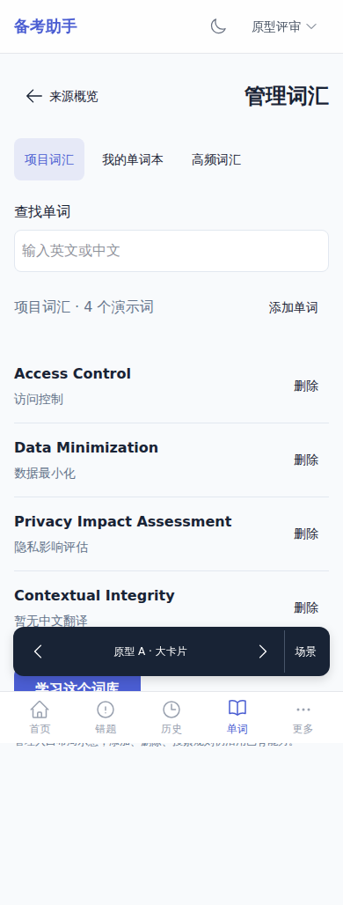

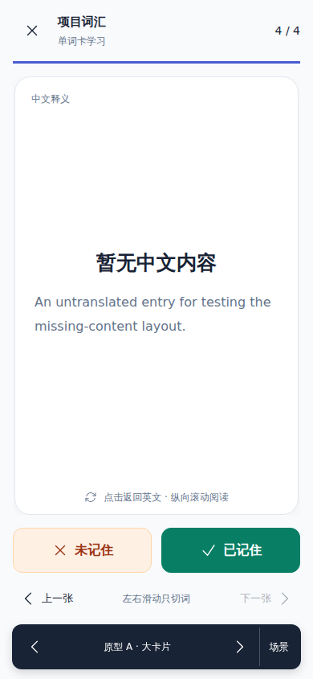
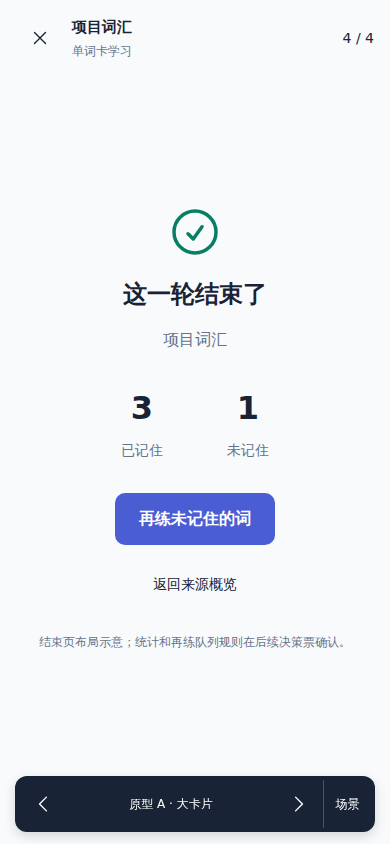
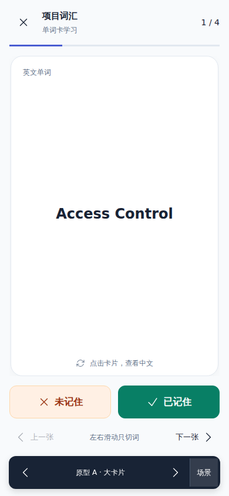

## 已做的原型检查

- 390×844 下的三种方案正／反面、长释义；1024×800 桌面保留全局导航。
- 320×568 下三种方案无横向溢出，判断按钮在视口内，长释义区域可滚动。
- 标记自动前进、结束页、仅重练明确标为未记住的演示词；横向拖动仅切词。
- 浏览器无 JavaScript 错误；所有演示 HTTP 请求为 GET，真实变更均未发送。
- `npm run build` 成功；原型仅在开发环境和显式原型标志启用，生产包不包含原型视图或 fixture。

这不是完整的回归测试，也不宣称已在真实 iOS／Android 设备验证安全区和原生手势。上线前的验证契约由最后一张决策票确认。
